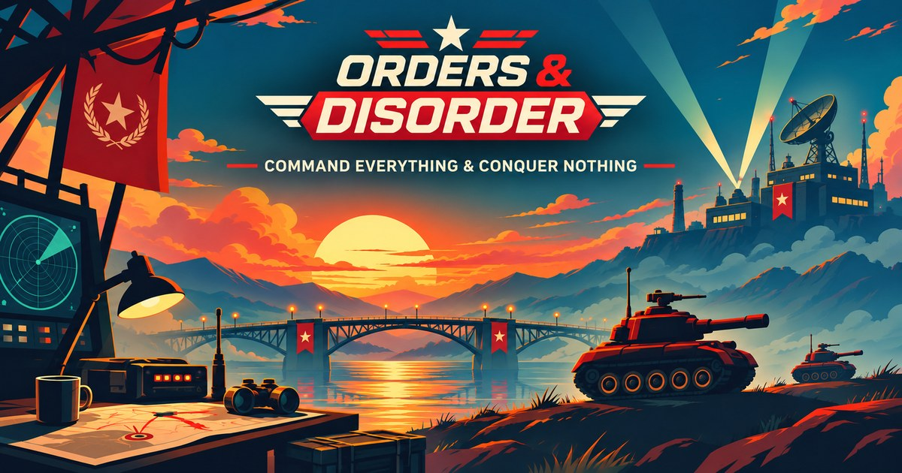

# Ninewashburn · Full Stack & Game Development

Développeur full stack. Applications web, API et projets interactifs, avec un intérêt particulier pour la
modernisation d’existant, l’architecture maintenable et le prototypage.

[Portfolio](https://renaudmeynadier.com) · [Jouer à Orders & Disorder](https://orders-disorder.vercel.app/)

## Projet phare : Orders & Disorder

Jeu de stratégie tactique au tour par tour, jouable dans le navigateur et conçu d’abord pour le téléphone.
Capturer des villes, tenir des ponts, produire une armée et prendre le QG adverse.

- 13 opérations, du tutoriel guidé aux batailles combinées terre, air et mer
- Plusieurs modes de victoire, IA en trois difficultés, deux joueurs sur le même appareil
- Atelier de cartes, sauvegarde locale avec export et import, français et anglais
- Moteur de règles sans DOM, tests automatisés et recettes navigateur en CI

`Phaser` `JavaScript` `Responsive` `CI/CD` · **[Jouer](https://orders-disorder.vercel.app/)**

## Autres projets personnels

| Projet | Description | Stack |
| --- | --- | --- |
| [Slay The Spreadsheet](https://github.com/Ninewashburn/Slay-The-Spreadsheet) | Deckbuilding roguelike autour de la recherche d’emploi | TypeScript · moteur déterministe |
| [Storyboard](https://github.com/Ninewashburn/Storyboard) | Prototype de storyboard assisté par IA : cadrage et mise en scène avant génération | Python · 3D · IA générative |
| [Bagni-Plage](https://github.com/Ninewashburn/Bagni-Plage) | Réservation d’emplacements de plage | Java · Spring Boot · Angular · PostgreSQL |
| [Dora Dashboard](https://github.com/Ninewashburn/Dora-Dashboard) | Visualisation des métriques DORA | Angular · FastAPI · Python |
| [Nîmes’Alerie](https://github.com/Ninewashburn/Nimes-Alerie) | E-commerce : catalogue, panier, commandes et back-office | Angular · Symfony · API Platform |
| [Security-Base](https://github.com/Ninewashburn/Security-Base) | Gestion d’incidents avec rôles, tableaux de bord et traçabilité | Laravel · Angular · PostgreSQL |

## Stack

| Domaine | Technologies |
| --- | --- |
| Frontend | Angular · React · Next.js · TypeScript · JavaScript |
| Backend & API | Laravel · Symfony · Java / Spring Boot · FastAPI · Node.js · API REST |
| Données & outils | PostgreSQL · MySQL · Docker · Git · GitHub Actions · CI/CD |
| Autres | Phaser · responsive mobile · prototypage · outils IA |
